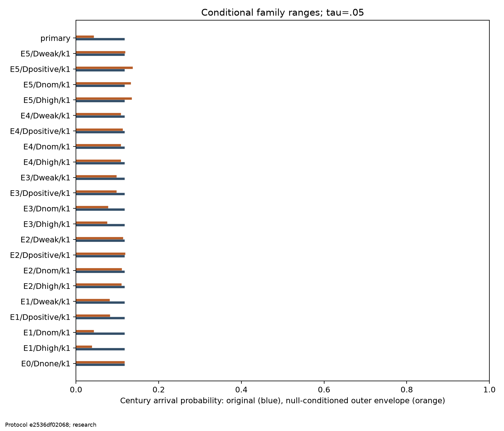
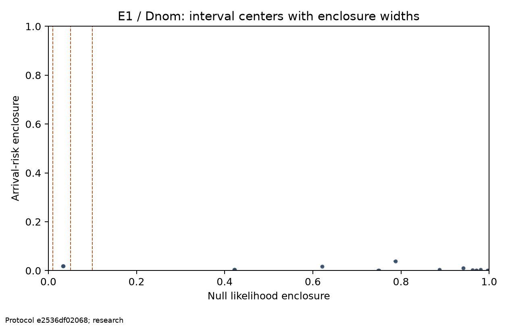
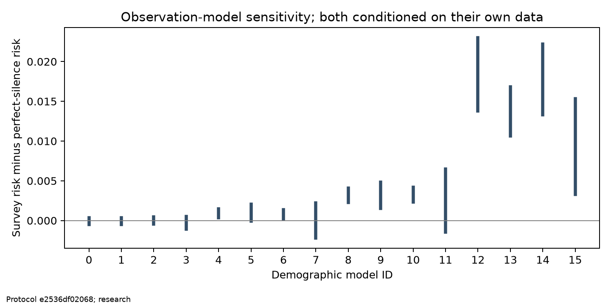
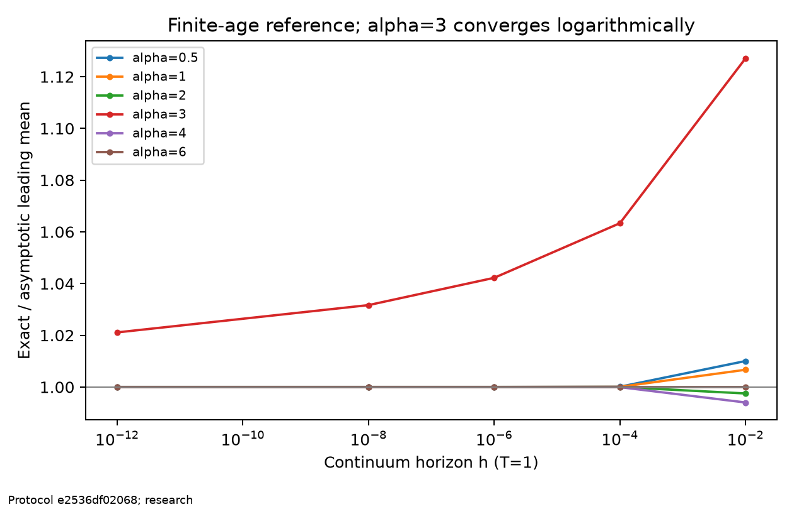

# SETI silence audit

The upper arrival-risk envelope materially narrows under this declared observation model.

Evidence grade: `coarsened_F1` / `assumed_F2`. Protocol `e2536df02068d88ef9b201fe27d3a06cd7a353e3a30d4337468d47f58756b6ab`.

Primary upper-envelope enclosures: before the null [0.11033240751588891, 0.1146119340372861]; after the null [0.035536062255209354, 0.04038605960750871]. Certified retained models: 14; possibly retained: 14.

This audit concerns physical arrival within 100 Julian years after the survey endpoint. Radio reception is a different event. Every modeled risk stipulates that Earth has not already been reached; a small survival probability C does not penalize a model.

## Scope and assumptions

Saved endpoint: `{"lower_utc": "2023-05-13T00:00:00Z", "upper_utc": "2023-05-15T00:00:00Z"}`.

Catalog summary: `{"duplicate_sites": {"1730.01": ["15", "38"]}, "physical_sites": 61, "source_rows": 62, "source_status": "source_verified"}`. Full source/configuration provenance is retained in the frozen protocol.

The research catalog has 62 published rows and 61 physical sites: TOI 1730.01 has two visits but one birthplace. The synthetic controls use their own explicitly declared geometry.

Measured survey information and source verification are distinct from assumed birth rates, historical age, expansion speeds, emission behavior, detector transfer, and future continuation. F1 preserves permitted observation intervals; F2 point-detector efficiencies remain assumptions. Zero-response Duncal and invisible counterparts prevent full-family contraction; a displayed outer [0,1] is not a claim that both endpoints are achievable.

The primary research family models only the catalog sites, equal potential-birth hazards, a 10,000-year start, mu in {.1,1,3,12}, and four declared speed laws. It is not a Galactic forecast. E1 assumes compatible, immediate, persistent emission; E2 has .1 compatibility, E3 delays emission 100 years, E4 has a 100-year radio life, and E5 has stationary .1 ON fraction with one-day correlation. E0 is invisible.

Dnom assumes .8836 final-pair recovery, Dweak .44, Dhigh .94, and Dpositive the full [.44,.94] interval. Duncal admits zero response. Numerical confidence refers to calculation under these assumptions, not to their astrophysical truth. Archive timing precision does not establish equal astrophysical precision.

The scientific comparisons are one-factor sensitivities. Future k=0/10 controls cover E1/E0, not every emission cross-combination. Age diagnostics hold mu fixed, not the present birth rate.

F1 already relaxes repeated-visit dependence, so its nominal and dependence-robust scenarios share the same enclosure. Dpositive's .44 lower response is an assumption, not an empirical calibration bound.

## Decisions and uncertainty

C is survival probability, likelihood is null probability conditional on survival, R0 is century-arrival risk before the radio null, and R is risk after the null. Weighted point estimates and certified intervals are separate. A null can increase a risk.

Compatibility retains likelihood >= tau; equality is retained. An entirely excluded family has no conditional family risk. Missing or invalid cells remain in the outer envelope. Material narrowing requires both absolute .01 and relative .25 upper-envelope contraction; a negative uses its own conservative certificate.

One independent history is the independent unit. Stars, visits, and paired variants are not extra replicates. Exact binomial audit intervals use the frozen registry and alpha=A/(M*j*(j+1)); thresholds reuse those intervals. Calibration/astrophysical uncertainty is separate from Monte Carlo confidence.

[Per-model table](../results/tables/model_rows.csv); [all family envelopes](../results/tables/family_envelopes.csv); [scoped conclusions](../results/conclusions.json).

[Demographic definitions](../results/tables/demographics.csv). Raw ideal-silence likelihood ratios are retained when noisy survival normalization makes the point exceed one; the displayed point is clipped and its conservative interval is unchanged.

## Interaction and observation sensitivity

[Matched interaction and ideal-silence differences](../results/tables/comparisons.csv). Differences retain their signs. Perfect simultaneous silence is an observation-model sensitivity, not a competitor using the same telescope data.

## Continuum reference

Saved deterministic status: `validated`. The warning display on PDF page 8 is damaged; the implemented warning formula is an independent repair from E8. Original source scripts were not supplied or reproduced. Continuum asymptotics are not imported as exponents for the finite stellar catalog.

[Exact/leading reference table](../results/tables/theorem_ratios.csv); [finite-shell trial counts and rigorous bounds](../results/tables/reference_checks.csv).

## Costs, failures, and missing work

Resource totals recorded before this rendering: `{"jobs_by_ledger": {"clean_installation": {"download_bytes": 0, "elapsed_seconds": 56.031857792055234, "history_evaluations": 0}, "fresh_confirmation": {"download_bytes": 0, "elapsed_seconds": 505.24284774507396, "history_evaluations": 79749854}, "matched_baselines": {"download_bytes": 0, "elapsed_seconds": 4.1382771249627694, "history_evaluations": 0}, "original_and_development": {"download_bytes": 389533, "elapsed_seconds": 1539.1696040793322, "history_evaluations": 22939662}}, "pending_job_ids": {"clean_installation": [], "fresh_confirmation": [], "matched_baselines": [], "original_and_development": []}, "phase_windows": {"fresh_confirmation": {"elapsed_window_seconds": 1238.532226, "first_recorded_start_utc": "2026-11-02T17:09:10.490291+00:00", "last_recorded_finish_utc": "2026-11-02T17:29:49.022517+00:00", "scope": "Observed phase window including computation, I/O, interruptions and prefetch; not CPU time."}, "original_and_development": {"elapsed_window_seconds": 1329.313925, "first_recorded_start_utc": "2026-11-02T16:41:45.873789+00:00", "last_recorded_finish_utc": "2026-11-02T17:03:55.187714+00:00", "scope": "Observed phase window including computation, I/O, interruptions and prefetch; not CPU time."}}, "recorded_history_evaluations": 102689516, "recorded_job_elapsed_seconds": 2104.582586741424, "recorded_utc": "2026-11-02T18:48:53.303982+00:00", "resource_archives": [{"archive_path": "results/resource_records.jsonl.gz", "archive_sha256": "23440a6455e57adcac2a0efaa0ddf2cdff8864e916770eb8ad5592e829fee32a", "compressed_bytes": 980609, "ledger": "original_and_development", "raw_bytes": 8418309, "raw_sha256": "d8be7de709f7d6dd9f86146d5785d0c6dbd25e8daafff19e4bebab6621cef19e"}, {"archive_path": "results/refinement/resource_records.jsonl.gz", "archive_sha256": "c4d86b914702f7a28919cebbcbfdac56fba8ce116102ac1039aace3e9f84a769", "compressed_bytes": 755122, "ledger": "fresh_confirmation", "raw_bytes": 6030342, "raw_sha256": "a1bca39fdebba57a95fcc8d4b5c27352215ed60872889f0e6634229f01cb35ae"}, {"archive_path": "results/baseline_precision/resource_records.jsonl.gz", "archive_sha256": "6ce3bdb99f911ee18853b1ae23da849a5fc13af274e6dffb84d293e66d83e4fa", "compressed_bytes": 320, "ledger": "matched_baselines", "raw_bytes": 529, "raw_sha256": "94014dc4941e2a2e0f40456c406122e1bbf951e97cba4a54be0ee300aed7897c"}, {"archive_path": "results/reproduction_resource_records.jsonl.gz", "archive_sha256": "7ee5e495e382e39e24abd1cef76748a2ecfa4575bac5165ddf60aad4223a41da", "compressed_bytes": 708, "ledger": "clean_installation", "raw_bytes": 2587, "raw_sha256": "166883716ec7a153db8bbc3df2021c64416457be6fbb28f1c09139fc6c67bb2e"}], "sampling": {"fresh_inference_histories": 16000000, "fresh_published_histories": 21385728, "original_sampled_histories": 6170000}, "scope": "Instrumented science, calibration, pilot and scalar-replay jobs. Historical unit-test simulator calls are not exhaustively totaled; their job durations are recorded. Durations include nested checks and must not be interpreted as unique wall time."}`. Recorded job durations include nested checks and are not unique elapsed wall time. Saved phase windows separately include computation, I/O and prefetch. The append-only resource ledger also records this rendering after it finishes.

Saved scientific environment: `{"architecture": "arm64", "cpu_available": null, "packages": {"matplotlib": "3.11.2", "mpmath": "1.4.1", "numpy": "2.5.4", "pytest": "9.2.0", "scipy": "1.18.1"}, "physical_memory_bytes": null, "precision": "CPU binary64", "python_version": "3.12.9"}`. Current report preflight: `{"available_memory_bytes": 16043098112, "bytes_required": 1, "disk_free_bytes": 131396366336, "disk_total_bytes": 930662584320, "memory_probe": "vm_stat free+inactive+speculative; reclaimable-memory estimate", "memory_probe_error": null}`.

Runtime estimates and sample checkpoints impose no deadline, launch allowance, byte quota, or maximum precision look. Actual capacity interruptions preserve resumable work. An interruption is not a scientific outcome.

Unperformed or invalid required result rows: `[]`.

## Artifacts

The continuous shared-efficiency refinement covers every p in [.44,.94] with contiguous subdomains; it assumes no monotonicity of conditional risk. Family envelopes use these tighter bounds where supplied. The original per-model table retains its coarse bounds; [refined subdomains](../results/tables/refined_subdomains.csv) provide the replacement evidence. Fresh stage-8 confirmation streams are independent of the original histories. Its error allowance comes only from analytically zero-error ideal-S1 intervals, preserving the original total error pool; no unused data-dependent checkpoint allowance is reclaimed.

Matched-baseline intervals use unweighted arrival flags from the same completed fresh checkpoint, for all 52 declared interacting baselines. They intersect the original baseline intervals. Two mathematically certain free-shell endpoint intervals fund these extra confidence events; together with the 12 ideal-S1 donors, the total Monte Carlo error allowance remains .05. [Baseline counts and intervals](../results/tables/baseline_intervals.csv). Extra prefetched batches remain recorded and are not promoted into a partial-look confidence claim.

[Evidence paths and hashes](../results/evidence.json). Report regeneration reads saved evidence and performs no acquisition or simulation.

One next empirical step is to obtain the complete observing and final-selection calibration package. Conditional numerical findings remain scoped to their declared model family.
